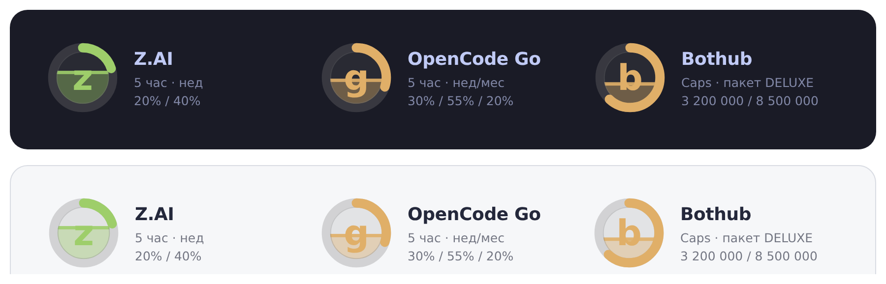

# OpenCode Z + Go limits


Плагин для OpenCode (GUI + TUI), который показывает остаток квот подписок:

- **Z.AI GLM Coding Plan** — 5-часовой и недельный пулы кредитов;
- **OpenCode Go** — 5-часовое (rolling), недельное и месячное окна расхода;
- **Bothub** — предоплаченный баланс Caps (bothub.chat).

<p align="center">
  
</p>

Бейдж в заголовке сессии (GUI) виден только когда выбрана модель соответствующей
подписки:

| Провайдер | Как определяется |
|---|---|
| OpenCode Go | `providerID` начинается с `opencode-go` или равен `opencode`, либо `modelID` начинается с `opencode-go/` |
| Z.AI | `providerID` начинается с `zai`, либо `modelID` начинается с `glm` |
| Bothub | `providerID` или `modelID` содержит `bothub` |

В TUI бейдж показывает квоту выбранной модели; если модель не из этих
провайдеров — сначала Z.AI (как в прежней версии), затем OpenCode Go.

Протестировано на OpenCode Desktop **v2.3.2** (Windows).
GUI-часть использует экспериментальный API (`gui-experimental`) — может
меняться между версиями приложения.

## Файлы

| Файл | Что это |
|---|---|
| `index.ts` | Серверная часть: запрашивает квоты Z.AI, OpenCode Go и баланс Bothub, кэш 30 с, отдаёт по RPC |
| `rpc.ts` | Общий RPC-контракт: `zai-quota.status`, `opencode-go-quota.status`, `bothub-quota.status` |
| `gui-experimental.cjs` | GUI-часть OpenCode Desktop (CommonJS без бандлера) |
| `tui.tsx` | TUI-часть: бейдж в футере + слэш-команда `/quota` |

## Что где показывается (GUI)

- **Заголовок сессии** (`session.header`): SVG-бейдж — буква внутри
  **кругового кольца-прогресса**.
  - `z` — Z.AI, прогресс по 5-часовому пулу;
  - `g` — OpenCode Go, прогресс по rolling-окну (5 часов);
  - `b` — Bothub, кольцо и фон показывают остаток купленного пакета Caps
    (если API вернул размер пакета `plan.tokens`); без пакета — просто буква.
  Цвет динамический: зелёный < 50 %, янтарный 50–80 %, красный ≥ 80 %
  (для Z.AI учитывается худший из двух пулов, для Go — худшее из трёх окон,
  для Bothub — доля израсходованного пакета).
  - **Фон кольца** заполняется снизу вверх и показывает запас «длинного»
    окна: у Z.AI — недельного, у Go — недельного или месячного (берётся то,
    что израсходовано сильнее и исчерпается первым; при равенстве — то, у
    которого раньше сброс). Высота = остаток в процентах от видимой
    внутренней области круга, граница уровня подчёркнута линией, а пустая
    часть остаётся тёмной — поэтому шкала читается и при почти полном баке.
    Так кольцо показывает «быстрое» окно, а заливка — «медленный» запас.
  Наведение — подсказка с деталями (включая запас длинного окна) и
  принудительное обновление. Клик по бейджу показывает сразу все подписки:

  ```
  OpenCodeGo: 4/100 (5 час, сброс: через 20мин); 23/100 (нед, сброс: через 3дн); 45/100 (мес, сброс: через 20дн)
  Zai: 4/1024 (5 час, сброс: через 2ч 24мин); 43/10434 (нед, сброс: через 22дн)
  Bothub: 399 122/8 500 000 Caps (остаток, пакет DELUXE)
  ```

  Для Go проценты показываются как `израсходовано/100`, для Z.AI —
  `currentValue/usage`, для Bothub — `остаток/размер пакета` (Caps).
  Если провайдер не вернул окно/план, оно не выводится.
- **Палитра команд**:
  - `Z.AI: квота Coding Plan`;
  - `OpenCode Go: квота`;
  - `Bothub: баланс`.

## Как это работает

```
api.z.ai ───────────────┐
opencode.ai/zen/go ─────┤
bothub.chat/api/v2 ─────┘
        │
        └──> серверная часть (index.ts, кэш 30 c)
                │ RPC zai-quota.status
                │ RPC opencode-go-quota.status
                │ RPC bothub-quota.status
                ├──> GUI (кольцо в заголовке сессии)
                └──> TUI (бейдж в футере, /quota)
```

Fetch делается в серверной части, а не в окне приложения, чтобы не зависеть
от CORS. Обновление раз в 60 с.

### Z.AI

Ответ api.z.ai: `data.limits` — пулы с `unit: 3` (5 часов) и `unit: 6`
(неделя), `data.level` — тариф (`lite`, `pro`, …). Отсутствующий пул
передаётся объектом с нулями (`usage: 0`).

### OpenCode Go

Запрос: `GET https://opencode.ai/zen/go/v1/usage` с
`Authorization: Bearer <ключ OpenCode Go>`.

Ответ (формат на момент проверки):

```json
{
  "usage": {
    "rolling": { "status": "ok", "percent": 12, "resetsAt": "2026-11-21T19:12:47.000Z" },
    "weekly":  { "status": "ok", "percent": 4,  "resetsAt": "2026-11-23T00:00:00.000Z" },
    "monthly": { "status": "ok", "percent": 2,  "resetsAt": "2026-12-21T14:04:22.000Z" }
  }
}
```

`percent` — сколько процентов окна израсходовано. `status` может быть
`ok` или `rate-limited`; отсутствующее окно передаётся как
`{ status: "unavailable", percent: 0, resetsAt: 0 }`.

### Bothub

Запрос: `GET https://bothub.chat/api/v2/auth/me` с
`Authorization: Bearer <API-ключ Bothub>` — тем же ключом, что используется
для инференса. Ответ (формат на момент проверки):

```json
{
  "subscription": {
    "balance": 399122,
    "availableBalance": 399122,
    "plan": { "type": "DELUXE", "tokens": 8500000, "price": 1500, "currency": "RUB" }
  }
}
```

`balance` — сырой баланс Caps, `availableBalance` — доступно с учётом
кредитного лимита, `plan.tokens` — размер купленного пакета. Caps не сгорают
и не сбрасываются по расписанию, поэтому вместо «сброса» показывается
`остаток/размер пакета`. Если `plan.tokens` нет или он равен нулю,
бейдж показывает только баланс без шкалы. После пополнения баланс может
стать больше размера пакета — тогда шкала считается заполненной на 100 %
(израсходовано 0).

## Установка

### 1. Ключи

**Z.AI** — первый найденный вариант:

1. переменная окружения `ZAI_API_KEY`, **или**
2. `~/.config/opencode/zai-quota.key` (Linux/macOS; желательно `chmod 600`), **или**
3. `%APPDATA%\opencode\zai-quota.key` (Windows), **или**
4. `$XDG_CONFIG_HOME/opencode/zai-quota.key`, **или**
5. активный ключ интеграции `zai-coding-plan` из хранилища OpenCode.

Если Z.AI уже подключён в OpenCode через `/connect`, отдельный файл не нужен:
ключ берётся из интеграции `zai-coding-plan`. Файл, если он есть, имеет
приоритет над интеграцией.

**OpenCode Go** — отдельный файл не обязателен. Ключ берётся автоматически
из хранилища интеграций OpenCode (тот, что сохраняется через `/connect` →
OpenCode Go). Порядок поиска:

1. переменная окружения `OPENCODE_GO_API_KEY` (или `OPENCODE_API_KEY`);
2. `~/.config/opencode/opencode-go-quota.key` — ручной override;
3. активный ключ интеграции `opencode-go` (или старой `opencode`);
4. legacy `~/.local/share/opencode/auth.json`.

Если ключ Go хранится в нестандартном месте, проще всего задать
`OPENCODE_GO_API_KEY` или положить файл `opencode-go-quota.key`.

**Bothub** — отдельный файл не обязателен. Ключ берётся из хранилища
интеграций OpenCode (если Bothub подключён через `/connect`), либо:

1. переменная окружения `BOTHUB_API_KEY`;
2. `~/.config/opencode/bothub-quota.key` (или `bothub.key`) — ручной override;
3. `%APPDATA%\opencode\bothub-quota.key`, `$XDG_CONFIG_HOME/opencode/...`;
4. активный ключ интеграции `bothub` / `bothub-chat`;
5. `~/.local/share/opencode/auth.json` — провайдер, в ID которого есть
   `bothub`.

Ключ создаётся в [личном кабинете Bothub](https://bothub.chat/profile/for-developers)
и подходит как для инференса, так и для чтения баланса.

### 2. Регистрация плагина

В глобальном конфиге OpenCode (`~/.config/opencode/opencode.json`, на Windows
`%USERPROFILE%\.config\opencode\opencode.json`):

```jsonc
{
  "$schema": "https://opencode.ai/config.json",
  "plugins": ["<путь к этой папке>"]
}
```

Пример пути: Linux — `/home/user/pj/OpenCodeZLimitsPlugin`,
Windows — `C:/Users/user/pj/OpenCodeZLimitsPlugin`.

Если каталог лежит в `~/.config/opencode/plugins/`, регистрация не нужна —
он загружается автоматически.

### 3. Перезапуск GUI

TUI-часть подхватывается на лету. GUI-часть (кольцо в заголовке) —
экспериментальный бандл, который окно загружает при старте; после изменения
плагина перезапустите OpenCode Desktop.

## Проверка RPC

```bash
opencode api post "/api/rpc/zai-quota/status?location[directory]=<каталог>" -d '{"input":{}}'
opencode api post "/api/rpc/opencode-go-quota/status?location[directory]=<каталог>" -d '{"input":{}}'
opencode api post "/api/rpc/bothub-quota/status?location[directory]=<каталог>" -d '{"input":{}}'
```

## Отладка

- Логи сервера: `~/.local/share/opencode/log/opencode.log`
  (`role=server` — серверная часть, `role=cli` — TUI).
- Логи Desktop: `~/.config/ai.opencode.desktop/logs/<метка времени>/`.
- Ошибки загрузки плагина ищите по `failed to load plugin ... zai-quota`.
- Ошибки запросов Go логируются как `opencode-go-quota: ...` (ключ в лог не пишется).
- Ошибки запросов Bothub логируются как `bothub-quota: ...` (ключ в лог не пишется).

## Известные ограничения

- GUI-поверхности (`session.header`, `TitlebarItem`) — экспериментальный API,
  имена слотов/полей могут поменяться в будущих версиях OpenCode.
- `gui-experimental.cjs` написан руками без бандлера и рассчитан на то, что
  приложение отдаёт плагину общие модули (`solid-js`,
  `@opencode/plugin/gui`, `@opencode/plugin/rpc`). Если в какой-то версии
  это сломается — собрать бандл через `@opencode/plugin/gui/vite`.
- Схемы RPC в `rpc.ts` намеренно упрощены (без union-типов, отсутствующее
  окно = `unavailable`): рантайм 2.2.7 падал на `Object.entries(undefined)`
  при более «умных» схемах.
- `/zen/go/v1/usage` не описан в публичной документации OpenCode. Если формат
  ответа изменится, бейдж Go покажет «нет данных», а не выдуманные числа.
- В ответе Go нет тарифа и денежного баланса — только проценты и время сброса.
- Bothub — предоплаченный баланс, а не квота со сбросом. Процент на кольце
  считается от `subscription.plan.tokens` (размера купленного пакета); если
  пакет неизвестен, показывается только баланс. `systemLimit`/`softLimit`
  из API не используются — их семантика не описана в OpenAPI.

## Авторство

- Исходный плагин для Z.AI: модель **GLM** (`GLM-5.3-Flash`) компании
  **Z.ai**, работавшая кодинг-агентом в OpenCode.
- Поддержка OpenCode Go и Bothub, чтение ключей из интеграций OpenCode и
  обновление документации: модель **DeepSeek V4.1 Flash 1017** (провайдер
  **OpenCode Go**), работавшая кодинг-агентом в OpenCode.
- Идея, постановка задач и проверка на живой среде: **AbcdRa**.
